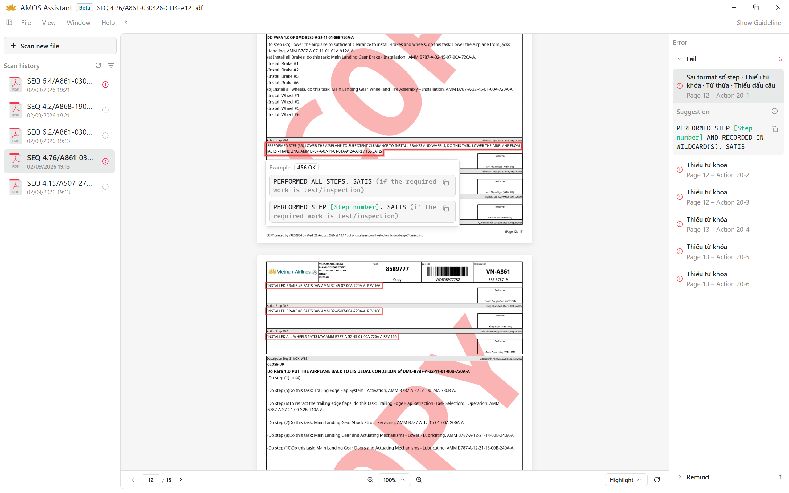

<div align="center">

# ✈️ AMOS Assistant

### Hệ Thống Tự Động Rà Soát Chứng Từ Kỹ Thuật Bảo Dưỡng Máy Bay

[](https://tauri.app/)
[](https://www.rust-lang.org/)
[](https://react.dev/)
[](https://www.typescriptlang.org/)
[](https://tailwindcss.com/)
[](https://www.sqlite.org/)
[](https://pdfium.googlesource.com/)
[](https://feature-sliced.design/)

<br />



*Giao diện trực quan của AMOS Assistant trong quá trình rà soát cú pháp hồ sơ Work Order PDF*

</div>

---

## 🎯 Giới thiệu sản phẩm

**AMOS Assistant** là giải pháp phần mềm chuyên dụng dành cho Kỹ sư và Chuyên viên kỹ thuật hàng không (**VAECO**), giải quyết bài toán rà soát thủ công hàng ngàn trang chứng từ bảo dưỡng máy bay.

Ứng dụng tự động hóa toàn bộ quy trình kiểm tra cú pháp kỹ thuật trong các bước thực hiện (**Workstep Actions**) của hồ sơ Work Order xuất từ hệ thống AMOS, định vị chính xác vị trí sai lệch và đưa ra câu gợi ý chuẩn hóa tức thì trước khi ký phát hành.

---

## ✨ Tính năng vượt trội

- 🔍 **Rà soát cú pháp chuẩn xác:** Phân tích trực tiếp text layer nhị phân của tài liệu PDF, đối soát với các bộ quy chuẩn kỹ thuật nghiêm ngặt (như `456.OK`, `456.FINDING`...), định vị bounding box và vẽ khung highlight màu trực tiếp trên trang tài liệu.
- 📺 **Khử mờ HiDPI ($2.0\times$ Supersampling):** Ứng dụng kỹ thuật Canvas Double-Buffering với độ phân giải siêu mẫu $2.0\times$, đảm bảo văn bản, mã hiệu kỹ thuật hiển thị sắc nét chuẩn vector trên mọi màn hình laptop và TV 1080p phòng điều hành.
- 📝 **Gợi ý chuẩn hóa & Sao chép 1-Click:** Tự động phát hiện lỗi sai cú pháp, thiếu từ khóa, lỗi định dạng số step và cung cấp câu gợi ý thay thế chuẩn kèm nút **Copy** tiện lợi.
- 🏷️ **Quản lý trạng thái & Bộ lọc đa tầng:** Lưu trữ trạng thái kiểm tra (`PASS`, `FAIL`, `REMIND`, `UNCHECKED`) vào SQLite cục bộ bền vững; hỗ trợ lọc đồng thời theo phân nhóm `SEQ`, trạng thái `Status` và sắp xếp theo ngày/tên tài liệu.
- 📖 **Cẩm nang Guideline QN tích hợp:** Tra cứu nhanh chóng bảng mẫu câu quy chuẩn, các ví dụ đúng/sai và ghi chú nghiệp vụ chỉ với một thao tác chuyển đổi trên thanh công cụ.

---

## 🛠️ Công nghệ cốt lõi (Tech Stack)

| Thành phần | Công nghệ | Vai trò trong hệ thống |
| :--- | :--- | :--- |
| **Native Core** |   | Quản lý vòng đời ứng dụng desktop, IPC type-safe, hiệu năng native tối ưu |
| **PDF Extraction** |  | Đọc trực tiếp text layer và trích xuất tọa độ hình học (Bounding Box) từng từ |
| **User Interface** |   | Giao diện người dùng hiện đại, kết xuất đồ họa mượt mà, phản hồi tức thì |
| **Language & Architecture** |   | Codebase chặt chẽ, kiến trúc phân tầng một chiều Feature-Sliced Design |
| **Data Persistence** |  | Cơ sở dữ liệu nội bộ với cơ chế Dual-Fallback chống lỗi phân quyền hệ điều hành |

---

## 📚 Hệ thống tài liệu chuyên sâu

Mọi khía cạnh kỹ thuật của hệ thống được quy hoạch rõ ràng trong 6 tài liệu chuyên biệt:

| Tài liệu | Nội dung chính |
| :--- | :--- |
| 🛠️ **[SETUP.md](./SETUP.md)** | **Cài đặt môi trường:** Hướng dẫn thiết lập từ đầu (Node.js, Rust, C++ tools, PDFium) và khắc phục các sự cố thường gặp. |
| 📖 **[GUIDE.md](./GUIDE.md)** | **Cẩm nang vận hành:** Hướng dẫn quét file, giải mã các màu highlight, đọc thẻ lỗi và tra cứu QN (đi kèm sẵn trong gói phát hành). |
| 🔄 **[WORKFLOW.md](./WORKFLOW.md)** | **Quy trình hoạt động:** Sơ đồ khối (Block Diagram) mô tả chi tiết luồng xử lý từ tiếp nhận PDF đến phản hồi giao diện. |
| 🏗️ **[ARCHITECTURE.md](./ARCHITECTURE.md)** | **Kiến trúc hệ thống:** Cây thư mục dự án, kiến trúc Frontend chuẩn FSD (`app`, `pages`, `shared`) và cây thư mục Backend Rust. |
| 📦 **[RELEASE.md](./RELEASE.md)** | **Phát hành & Phân phối:** Bảng danh mục các gói cài đặt (Portable ZIP, Setup exe, MSI) và lệnh đóng gói cho lập trình viên. |
| 🧪 **[TEST.md](./TEST.md)** | **Kiểm thử & Độ bao phủ:** Báo cáo 398 tests frontend (Coverage 98.77%), 53 tests Rust (tự động cập nhật số liệu thời gian thực). |

---

## ⚡ Bắt đầu nhanh (Quick Start)

Nhánh `main` tập trung vào không gian PDF và không cần runtime AI hoặc model GGUF. Agent được giữ trên nhánh `codex/paused-agent`; Workpackage và Training Schedule được giữ trên `codex/paused-workpackage-training` để phát triển tiếp sau. Xem [BRANCHES.md](./BRANCHES.md) để chuyển nhánh.

Dành cho lập trình viên muốn thiết lập môi trường và chạy ứng dụng từ mã nguồn:

```powershell
# 1. Cài đặt tự động toàn bộ môi trường (1-Click Setup)
powershell -ExecutionPolicy Bypass -File ./scripts/setup.ps1

# 2. Khởi chạy ứng dụng ở chế độ Development
pnpm tauri dev
```

> 📌 *Xem chi tiết yêu cầu môi trường, cài đặt công cụ và khắc phục sự cố tại **[SETUP.md](./SETUP.md)**.*

---

<div align="center">
  <sub>Phát triển bởi đội ngũ kỹ thuật VAECO • 2026</sub>
</div>
